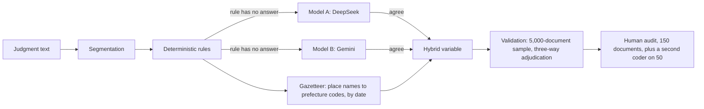

# Extracting defendant background from Chinese criminal judgments with rules and two LLMs

This repository holds the text-measurement pipeline behind a working paper on criminal procedure in China. It turns about one million published criminal judgments (Zhang, Kwan & Fang, *Scientific Data*) into document-level variables that exist only in unstructured text: where the defendant comes from, whether they live locally, whether they were detained at judgment, which procedure was used, and the sentence. Estimation code and results are not included.

## Pipeline



1. **Rules first.** `src/segment.py` splits each judgment into the defendant, facts, reasoning and verdict sections; `src/extract_rules.py` codes every document. Origin is taken from household registration, then birthplace, then native place; the current address is kept as a separate residence variable and never used for origin.
2. **Gazetteer.** `src/gazetteer.py` maps place names to prefecture codes as of the judgment date, handling renamed and merged units (built on the CC0 `yescallop/areacodes` table in `data/external/`).
3. **Two LLMs from different providers** (`src/llm_extract.py`, prompts in `prompts/`) read the defendant and verdict sections at temperature 0 under a frozen prompt. They return only verbatim text spans; every derived indicator is computed in code. A model value enters the data only where the rules have no answer and the two models agree.
4. **Validation.** On a stratified sample of 5,000 documents, rules and both models code every field and disagreements go to an anonymised, randomly ordered adjudication round. A human audit of 150 documents drawn with known inclusion probabilities gives weighted accuracy; a block of 30 documents is audited without the AI hints, to test whether the hints anchor the auditor (`src/ai_review.py`, `scripts/T05a_ai_prereview.py`).

## Validation results

All figures are read from `output/tables/`.

| Field | Model A vs B agreement (V) | Audit accuracy, hybrid (95% CI) |
|---|---|---|
| Non-local origin | 0.987 | 97.8% (94.6–100) |
| Local residence | 0.960 | 99.8% (99.5–100) |
| Status at judgment | 0.997 | 96.3% (93.0–99.7) |
| Probation | 1.000 | 100% |
| Sentence (months) | 0.993 | 98.0% (94.8–100) |

- Where the rules fail, agreeing model answers recover 51% of origins, 21% of residences and 86–97% of verdict fields (`T06b_R_fill_summary.csv`).
- A second coder, blind to all prefilled values, matched the first on 50 documents in every field except one status call (status agreement 0.98, κ 0.96).
- Audited documents with AI hints were changed about as often as blind ones (18.3% vs 16.7%, bootstrap CI of the difference −14.2 to 15.8 points).
- Production API cost: about USD 45 for both models (`T06b_cost.csv`).

## Design choices worth noting

- Models never output a derived variable, only text spans; a prompt revision after a 200-document pilot removed two error types (detention inferred from sentence-credit boilerplate, residence used as origin; `T06a2_error_types.csv`).
- Every API response is cached under a hash of model, prompt version, generation settings and input. With `PAPERB_LLM_OFFLINE=1` a cache miss raises an error instead of calling the API, so rebuilding the data never spends money or changes values.

## Layout

```
src/        segmentation, rules, gazetteer, number parsing, LLM interface, audit helpers, silver labels
scripts/    one script per step (see below)
prompts/    extraction, adjudication and audit-review prompts (Chinese, as applied to the text)
tests/      pytest suite; tests that need the judgment data skip automatically
output/     aggregate validation tables
data/external/  areacodes gazetteer (CC0)
```

| Step | Script |
|---|---|
| Working data from the raw corpus | `T01_build_working_data.py` |
| Sample flags, court city, rule extraction | `T02_build_sample.py`, `T02_extract.py` |
| Validation sample V | `T04_sample.py` |
| LLM pilot and production runs, adjudication | `T06a_pilot.py`, `T06b_run.py`, `T06b_report.py` |
| Hybrid variables, audit workbook, analysis file | `T06b_post.py`, `T09a_build_panel.py` |
| AI pre-review for the audit | `T05a_ai_prereview.py` |
| Second-coder agreement | `T18_coder2_agreement.py` |
| Gazetteer corrections | `T19_geo_fix.py` |

## Data and reproduction

Judgment texts and document-level data are not redistributed. The source corpus is public: Zhang, Y., Kwan, M.-P., & Fang, L. An LLM driven dataset on the spatiotemporal distributions of street and neighborhood crime in China. *Scientific Data*. Set its location with `PAPERB_RAW_ROOT` (see `src/paths.py`).

Python 3.13; `pip install -r requirements.txt`; `pytest`. Calling the APIs needs keys in a local `.env`, which is not part of the repository.

## License

Code: MIT (see `LICENSE`). `data/external/areacodes_result.csv` is from yescallop/areacodes and is CC0. The judgment corpus is not included and keeps its own terms.
